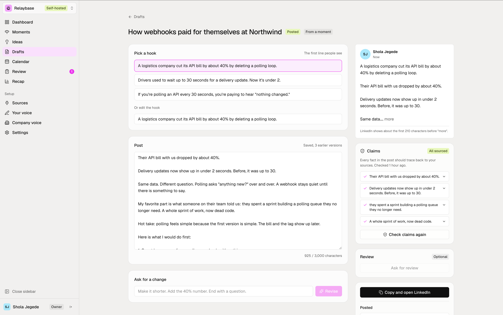
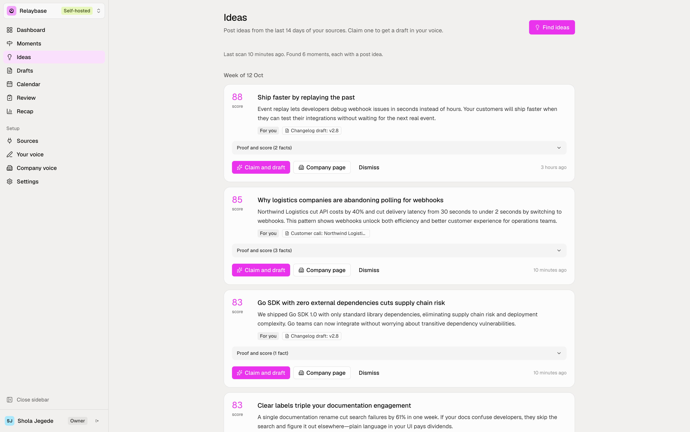
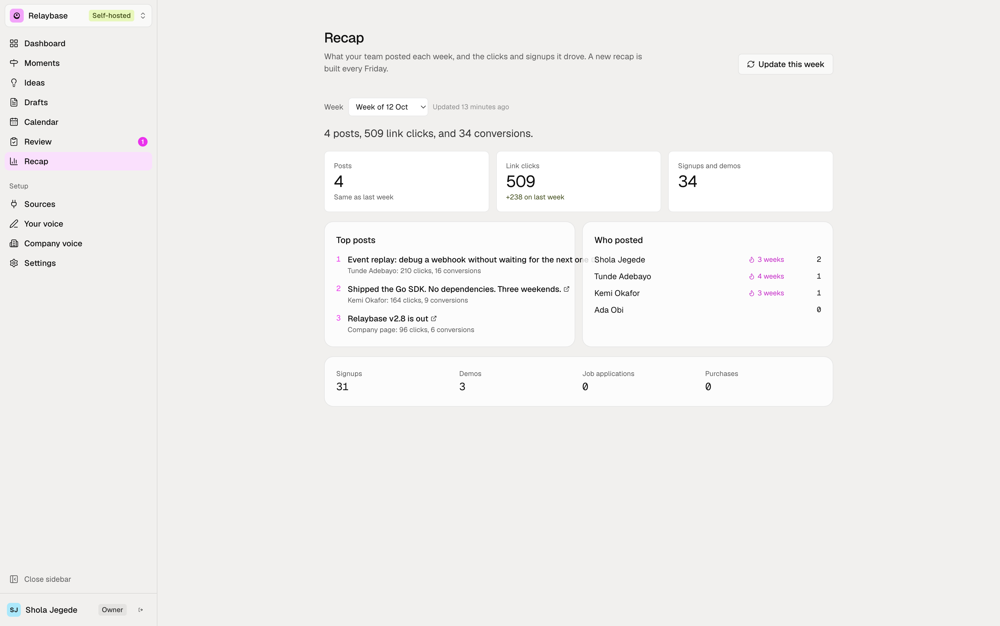
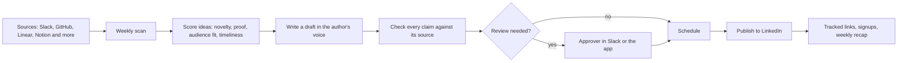

<p align="center">
  <a href="https://opentopost.com">
    <picture>
      <source media="(prefers-color-scheme: dark)" srcset="public/brand/logo-white.svg">
      
    </picture>
  </a>
</p>

<h3 align="center">The content engine for teams that ship.</h3>

<p align="center">
  It reads what your team already does, writes a post for the person who did the work, checks every claim against its source, and shows which posts brought signups.
</p>

<p align="center">
  <a href="https://opentopost.com">Website</a> ·
  <a href="https://opentopost.com/pricing">Hosted plans</a> ·
  <a href="docs/self-hosting.md">Self-host</a> ·
  <a href="docs/agents.md">Agents and API</a> ·
  <a href="docs/architecture.md">Architecture</a> ·
  <a href="CONTRIBUTING.md">Contribute</a>
</p>

<p align="center">
  <a href="https://github.com/opentopost/opentopost/actions/workflows/ci.yml"></a>
  <a href="LICENSE"></a>
  <a href="https://github.com/opentopost/opentopost/stargazers"></a>
  <a href="https://github.com/opentopost/opentopost/commits/main"></a>
</p>

<p align="center">
  
</p>

## What it does

Teams ship a lot and post very little. Nobody has the idea, the time, or the habit. opentopost removes the blank page.

1. **Reads your work.** Slack, GitHub, Linear, Notion, Jira, Google Docs, RSS, Intercom, Zendesk, and any MCP server. Eleven sources, all read-only.
2. **Finds the posts.** Each week it turns activity into ideas and scores them on novelty, proof, audience fit, and timeliness. Each idea goes to the person who did the work.
3. **Writes in their voice.** Voice profiles come from a person's own posts, recordings, or screenshots. A company voice sits on top.
4. **Shows its proof.** Every claim links to the quote it came from. A claim with no source is flagged, and it cannot be scheduled.
5. **Keeps a person in charge.** Optional review, company rules, roles, and an audit log. Drafts arrive in Slack with Approve, Edit, and Pass buttons.
6. **Publishes and measures.** Posts publish on schedule to a person's own LinkedIn. Tracked links, HubSpot and Attio, and a weekly recap show which posts brought signups.
7. **Runs from an agent.** An MCP server, a REST API, and signed webhooks cover every step.

<p align="center">
  
  
</p>

## How it works



The model proposes, the system checks, and a person decides. Autopilot is a plain function outside the model. It schedules a draft only when every claim has a source, no review is required, and the author connected LinkedIn. Read [the architecture](docs/architecture.md) for the parts.

## Hosted or self-hosted

| | Self-hosted | Hosted at [opentopost.com](https://opentopost.com) |
| --- | --- | --- |
| Price | Free | Free plan with your own key. Paid plans include the AI. |
| Model | Your own Claude, Gemini, OpenAI, or OpenRouter key | Included on paid plans, or bring your own |
| Setup | You run Convex and Kinde, and the Slack, GitHub, and LinkedIn apps you want | Sign in and connect your sources |
| Data | Your deployment | Ours |
| Updates | You pull them | Automatic |
| Support | GitHub issues | Direct from the team |

## Quick start

```bash
git clone https://github.com/opentopost/opentopost.git
cd opentopost
npm install
npx convex dev   # first terminal: creates your Convex project
npm run dev      # second terminal: http://localhost:3000
```

Before the app starts you also need a Kinde application and three values on your Convex deployment. The [self-hosting guide](docs/self-hosting.md) has each step.

## Documentation

| Guide | What is in it |
| --- | --- |
| [Self-hosting](docs/self-hosting.md) | Run it locally, environment values, how model keys are stored |
| [Integrations](docs/integrations.md) | Slack, GitHub, LinkedIn, more sources, MCP servers, signup tracking, HubSpot and Attio |
| [Agents and API](docs/agents.md) | MCP, the REST API, API keys and scopes, webhooks |
| [Architecture](docs/architecture.md) | The parts, the data model, and the rules the system follows |
| [Security and roles](docs/security.md) | Roles, audit log, retention, analytics |

## Built with

- [Next.js](https://nextjs.org) App Router on [Vercel](https://vercel.com)
- [Convex](https://convex.dev) for the database, server functions, cron jobs, and HTTP routes
- [Kinde](https://kinde.com) for sign-in, organizations, SSO, and SCIM
- [Vercel AI SDK](https://ai-sdk.dev) for the model providers

## Contributing

Open an issue first for anything bigger than a small fix. [CONTRIBUTING.md](CONTRIBUTING.md) has the steps. To report a vulnerability, read [SECURITY.md](SECURITY.md).

## License

opentopost is licensed under the [GNU Affero General Public License v3.0](LICENSE). You can use, change, and self-host it. If you run a changed copy as a network service for other people, you must make your changes available to them under the same license.
