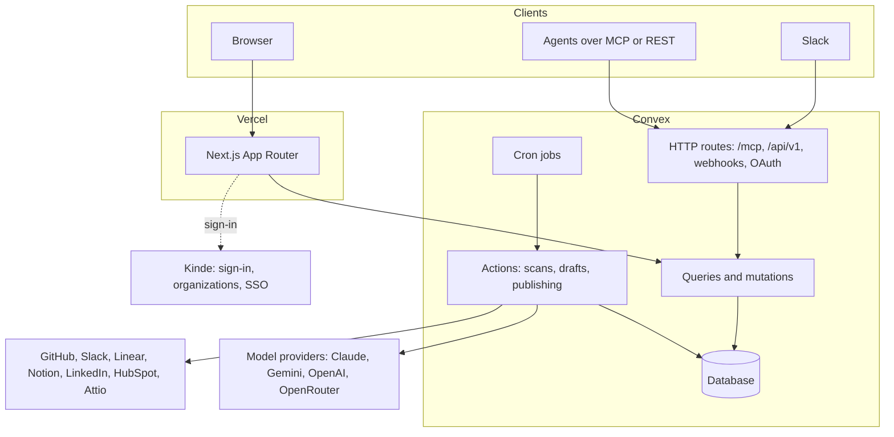

# Architecture

opentopost is a Next.js app on top of a Convex backend. Almost everything that matters happens in Convex, so the same code runs for the hosted version and for a self-hosted copy.

## The parts

| Part | What it does | Where |
| --- | --- | --- |
| Web app | Pages for ideas, drafts, review, calendar, recap, and settings. Marketing pages and the free LinkedIn photo tool. | `src/app` |
| Backend | The data, the rules, and every scheduled job | `convex/` |
| Sign-in | Kinde handles sign-in, organizations, SSO, and SCIM. | `convex/auth.config.ts` |
| Models | One function wraps every provider and returns validated, structured output | `convex/lib/ai.ts` |
| Agent access | The MCP server and the REST API share one list of tools and one set of scopes | `convex/mcp.ts`, `convex/agentHttp.ts` |

## What runs on its own

Convex cron jobs start the work, and actions do it. A person never has to start a scan.

| Job | Schedule |
| --- | --- |
| Find post ideas | Daily. Each workspace scans on its chosen day. |
| Weekly recaps | Fridays |
| Sync HubSpot and Attio conversions | Hourly |
| Apply source retention | Daily |
| Remove old analytics events | Daily |

After a scan, opentopost writes each person's best idea as a draft and sends it to them in Slack. A person approves it, edits it, or passes. A workspace owner can turn this off in Settings > Publishing.

## The rules the system follows

These rules live in code, outside the model, so text in a source cannot change them.

- **Every claim needs a source.** A draft is checked after it is written. A claim with no source is flagged and cannot be scheduled.
- **The model never calls tools.** Scans run the read tools an owner chose, with a fixed input. Text inside a source cannot make opentopost act.
- **Autopilot is conservative.** It schedules a draft only when the workspace turned it on, the post is a personal LinkedIn post, every claim has a source, no review is required, and the author connected LinkedIn. Company-page posts always wait for a person.
- **Everything is audited.** Every draft, review, schedule, post, key, webhook, role, and setting change records who did it and whether it came from the app, the API, Slack, or the system.
- **Keys are encrypted.** Model keys and source credentials are checked with the provider, then encrypted with AES-256-GCM. No query returns a key.

## Data model

The main tables, in the order a post moves through them.

| Table | Holds |
| --- | --- |
| `workspaces`, `members` | A team and its people, with roles |
| `sources`, `sourceItems` | Each connection and what was read from it |
| `moments` | Things the team did that are worth telling |
| `ideas` | A scored post idea for a moment, with a suggested person |
| `voiceProfiles`, `voiceSamples` | How each person writes |
| `drafts`, `draftEvents` | The post, its claims, its review state, and its history |
| `posts`, `trackedLinks`, `conversions` | What was published and what it brought |
| `recaps` | The weekly summary per team and per person |
| `apiKeys`, `webhooks`, `auditLog` | Agent access and the record of changes |

`convex/schema.ts` is the source of truth.
